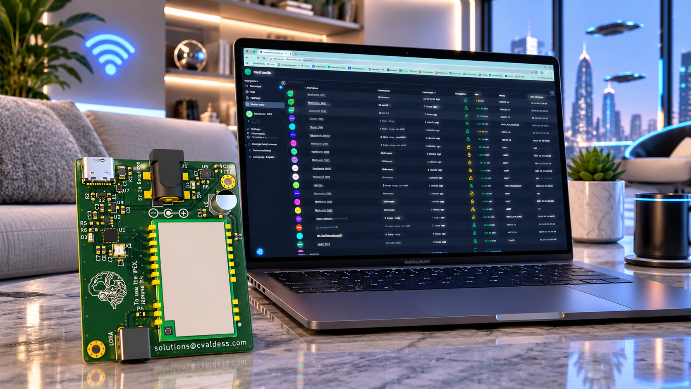
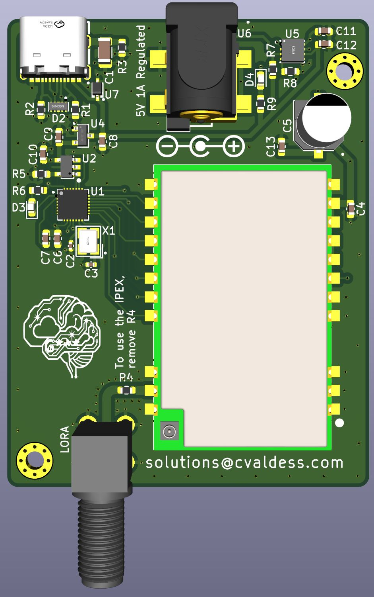
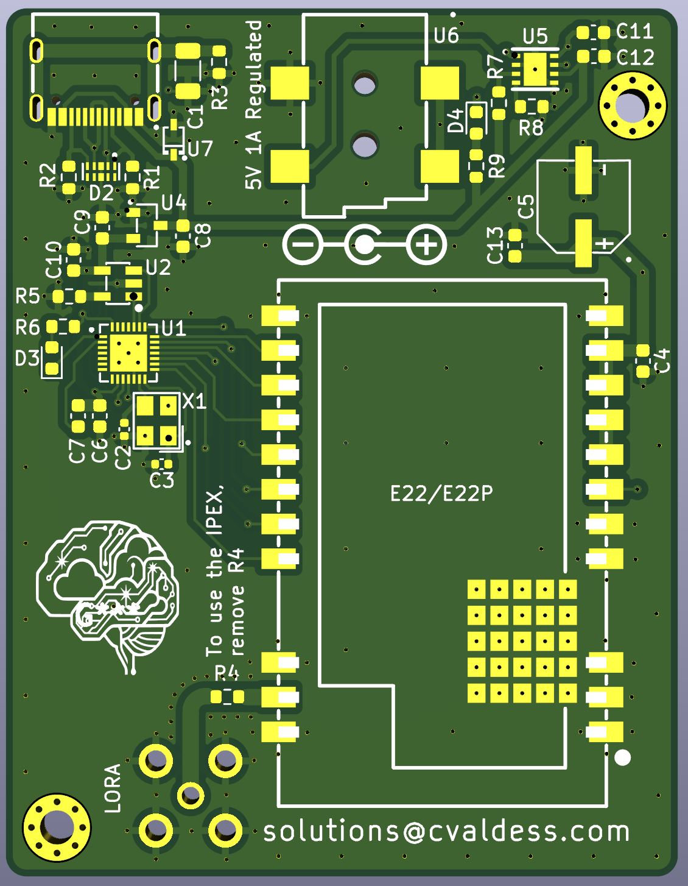

# usb_ch341_e22p

**USB → SPI** adapter for using an **EBYTE E22P-868M30S** LoRa module (SX1262 + PA, 30 dBm / 1 W) with **[meshtasticd](https://meshtastic.org/docs/software/linux/)** on a PC or a Raspberry Pi, with no GPIO needed.



<a href="https://www.pcbway.com/project/shareproject/usb_ch341_e22p_33f0f076.html"></a>

The bridge is a **CH341F** in UIO mode, the mode supported by Meshtastic's [`libch341-spi-userspace`](https://github.com/meshtastic/libch341-spi-userspace) driver. A **TPS2115A** power multiplexer switches automatically between USB power and a DC jack, so the module can transmit at full power without overloading the computer's port.

---

## Specifications

| | |
|---|---|
| PCB | 49.22 × 63.54 mm · **2 layers** · 1.6 mm · vias 0.6/0.3 mm |
| USB bridge | CH341F (QFN-28), parallel/synchronous mode (PID `0x5512`) |
| Radio | EBYTE E22P-868M30S — SX1262 + PA, up to **30 dBm**, 868 MHz |
| Power | USB-C 5 V **or** 5 V DC jack (2.5 mm), automatic switchover |
| Current limit | 1.28 A nominal (TPS2115A with `R8` = 390 Ω) |
| Logic | 3.3 V (XC6206 LDO), the E22P's logic level |
| Antenna | Right-angle female SMA, 50 Ω |
| Configuration | 24C02 EEPROM for VID/PID/mode |




## How the power path works

This is the least obvious part of the design. The E22P draws **600–670 mA when transmitting at 30 dBm**, more than a USB port guarantees (500 mA). The board handles this with a multiplexer whose source selection is **deterministic**, not based on comparing voltages:

| USB | Jack | `D1` | `D0` | Active source | LED `D4` |
|:---:|:----:|:----:|:----:|---|:---:|
| ✅ | ❌ | 0 | 0 | **USB** — use reduced power | off |
| ✅ | ✅ | 1 | 0 | **Jack** — full power | **on** |
| ❌ | ✅ | 0 | 0 | none (Hi-Z) | — |
| ❌ | ❌ | 0 | 0 | none (Hi-Z) | — |

`D0` is tied to ground and `D1` is driven by the jack's switch contact, with `R7` (10 kΩ) pulled up to **VBUS**. So `D1` encodes *"jack present **and** USB present"*, which gives two useful properties:

- With the jack plugged in, **the jack always wins**, whichever source has the higher voltage (both useful rows use `D0`=0, where the TPS2115A truth table ignores the `IN2>IN1` comparison).
- **Without USB the module is left unpowered**, which is intended: the board is useless when disconnected from the host, and this prevents a powered E22P from back-feeding current through the pins of an unpowered CH341.

LED `D4` hangs off `STAT`, which is open-drain and pulls low when `IN1` is active: **on = running from the jack**.

## meshtasticd configuration

The CH341 pins are numbered as UIO lines `D0`–`D7`. This board's pin mapping matches the official `lora-usb-meshtoad-e22.yaml` preset:

```yaml
Lora:
  Module: sx1262
  CS: 0        # D0 · pin 15 → NSS
  RXen: 1      # D1 · pin 16 → EN   (RF front-end enable)
  Reset: 2     # D2 · pin 17 → NRST
  Busy: 4      # D4 · pin 19 → BUSY
  IRQ: 6       # D6 · pin 21 → DIO1
  spidev: ch341
  DIO2_AS_RF_SWITCH: true
  DIO3_TCXO_VOLTAGE: true
  USB_VID: 0x1A86
  USB_PID: 0x5512
  # When powered ONLY from USB, lower the power so the port is not overloaded:
  # SX126X_MAX_POWER: 10
```

`SCK` is on `D3` (pin 18) and `MOSI` on `D5` (pin 20); `MISO` is on `D7` (pin 22), which, like `D6`, is a fixed input on the CH341. `DIO2_AS_RF_SWITCH` is mandatory: on the board, the `DIO2` pin is bridged to `T/R CTRL`, as note ① of the EBYTE manual specifies.

> [!IMPORTANT]
> **EEPROM `U2` must be programmed** with `MODE = 0x12` for the CH341 to enumerate as a parallel/synchronous port. Unprogrammed, the chip reads floating `SDA`/`SCL` and boots as a **serial port**, not as SPI. It is programmed over USB with `CH341CFG` or `IMSProg`.

## Manufacturing

Everything you need is in [`fab/`](fab/):

| File | Purpose |
|---|---|
| `gerbers-pcbway.zip` | Gerbers + drill files + drill maps, ready to upload to PCBWay |
| `bom-pcbway.csv` | Bill of materials: manufacturer, part number, LCSC code and assembly notes |
| `centroid-pcbway.csv` | Placement positions for assembly (the 34 SMD parts) |
| `*-drl_map.pdf` | Drill map, for a quick visual check |
| `*.gtp` / `*.gbp` | Paste layers, in case you order a stencil |

Parameters: **2 layers, 1.6 mm, HASL or ENIG**. Nothing beyond standard capabilities. The stencil is **single-sided** (top): the bottom paste layer is empty.

### BOM notes

- **Every part has an LCSC code**, passives included. The code for `U3` (E22P-868M30S, `C51912689`) is only in the BOM, not in the schematic.
- **`SMA1` is through-hole**: it is in the BOM but not in the centroid file, and is soldered after reflow. The 4 shell legs of `USB1` are through-hole too.
- **The centroid gives the centre of each part's body.** For `U3`, `USB1` and `U6` this is not the footprint origin (it is 1.41, 1.15 and 0.65 mm away); the BOM says so in their notes.

## Main components

| Ref | Part | Function |
|---|---|---|
| `U1` | CH341F | USB ↔ SPI bridge |
| `U2` | 24C02 | Configuration EEPROM (VID/PID/mode) |
| `U3` | E22P-868M30S | SX1262 + PA LoRa module |
| `U4` | XC6206P332MR | 3.3 V LDO for the CH341 |
| `U5` | TPS2115A | Power multiplexer |
| `U6` | DC-005-2.5A | 5 V DC jack with switch contact |
| `U7` | H7VHD3UA | TVS protection on VBUS |
| `D2` | TPD4E05U06 | USB ESD protection (D+/D−/CC1/CC2) |
| `C5` | 470 µF / 16 V | Solid polymer, 28 mΩ ESR — reservoir for TX peaks |

## Datasheets

The PDFs are not included in the repository (they are copyrighted by their manufacturers). Links to the sources:

- [CH341 (WCH)](https://www.wch-ic.com/products/CH341.html) · [E22P-868M30S (EBYTE)](https://www.cdebyte.com/products/E22P-868M30S) · [TPS2115A (TI)](https://www.ti.com/product/TPS2115A) · [TPD4E05U06 (TI)](https://www.ti.com/product/TPD4E05U06) · [XC6206 (Torex)](https://www.torexsemi.com/products/voltage-regulators/xc6206/)
- LCSC references: `C412870` (CH341F) · `C2863458` (TPS2115A) · `C138714` (TPD4E05U06) · `C20615807` (H7VHD3UA) · `C709357` (USB-C) · `C2880544` (jack) · `C9002` (crystal)

## Known limitations

- **No protection on the jack input.** There is no TVS and no reverse-polarity protection on `IN1`. The E22P is damaged above 5.5 V and the TPS2115A has an absolute maximum of 6 V: a 9 V or 12 V supply, or a centre-negative one, destroys both. **Use 5 V only and check the polarity.**
- **TX power is not detected automatically.** meshtasticd does not know whether the jack is plugged in, so `SX126X_MAX_POWER` is a fixed setting. If you will only use the board on USB power, lower it.
